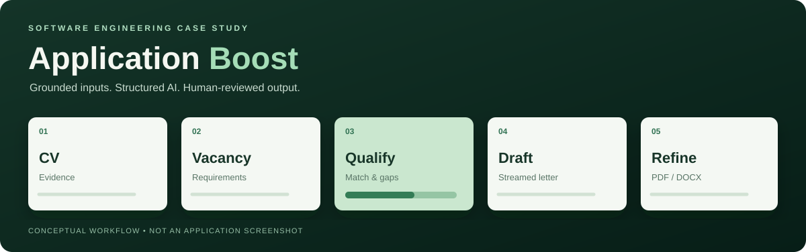
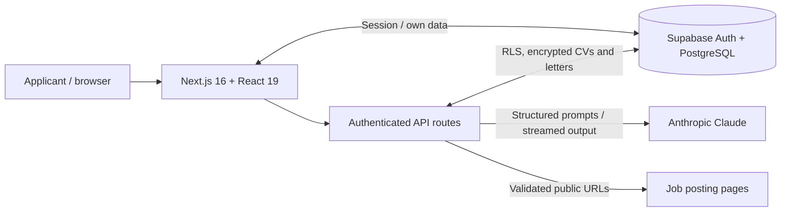

# Application Boost

**An AI-assisted job application workflow built around evidence, not boilerplate.**



[](https://github.com/stephanboner/application-boost/actions/workflows/ci.yml) [](https://github.com/stephanboner/application-boost/actions/workflows/secret-scan.yml)
  

### Try the live prototype

**[Open BewerbungsBoost ↗](https://bewerbungsboost.stephanboner.ch/)** — explore the application in your browser, from CV import and job analysis to an editable AI-assisted cover letter. **Please use fictional/test data only.** This public-facing prototype is not approved for real personal applicant information or production use.

**Independent software engineering project by Stephan Boner.** The application UI is called *BewerbungsBoost*; *Application Boost* is its portfolio repository. It is a technical proof of concept, **not an operated public service**. Please use fictional test data only.

BewerbungsBoost is a full-stack AI application prototype that helps applicants understand a vacancy, compare it with their experience, and draft a tailored cover letter. It combines structured CV data, job-posting extraction, an AI-assisted fit assessment, and an editable letter workflow.

> **Prototype / proof of concept.** Use synthetic or dummy applicant data only. This project is not a validated production service, and its match percentage is an AI-generated assessment, not a hiring prediction.

## The problem

Generic cover-letter generators are easy to use but often produce unsubstantiated claims or forget important job requirements. This prototype explores a more structured workflow: extract the requirements, identify evidence in the applicant's CV, ask for missing context, then produce a draft the applicant can inspect and edit.

## What it does

1. **Build a profile:** enter CV details manually or import text from a PDF/DOCX file (up to 4 MB).
2. **Understand a vacancy:** paste its text or provide a public job URL. The server extracts a structured job description; unreadable URLs fall back to pasted text.
3. **Qualify the fit:** compare the job with documented experience, review strengths and gaps, and add relevant motivation or missing context. The optional fit score can be unavailable.
4. **Draft and refine:** stream a tailored cover letter, edit the text and address, select language/tone, and export as PDF or Word.
5. **Return to previous applications:** authenticated users can revisit saved letters and delete their own PoC data.

The interface has 11 locales. CI checks that their translation catalogues have matching keys and placeholders; automated checks do not replace proofreading by native speakers.

## Where the engineering gets interesting

| Challenge | Design choice | Relevant code |
| --- | --- | --- |
| Unreliable model output | Structured vacancy extraction, schema + semantic validation | [Job parsing](src/app/api/parse-job/route.ts), [output schemas](src/lib/job-output-schema.ts) |
| Invented qualifications | Separate CV, requirement, matching and writing stages with evidence-oriented prompts | [Prompts](src/lib/prompts.ts), [CV matching](src/lib/cv-matching.ts) |
| Untrusted job URLs | DNS/IP and redirect checks, pinned external fetch, size caps and manual-text fallback | [URL safety](src/lib/url-safety.ts), [job content](src/lib/job-content.ts) |
| Partial streamed responses | A successful provider completion **and** saved encrypted letter are required before the final success event | [SSE generation](src/lib/letter-generation.ts) |
| Applicant data protection | Server-side AES-256-GCM, Supabase Auth, PostgreSQL row-level security | [Encryption](src/lib/encryption.ts), [schema](supabase/schema.sql) |
| Unbounded model spend | Authenticated rate limits and shared daily model budgets | [Quota controls](src/lib/ai-budget.ts), [rate limits](src/lib/rate-limit.ts) |

The trade-off: several stages add latency and cost, but enable narrower validations and recoverable failure modes. This is **not a claim of measured writing-quality improvements**. See [engineering decisions](docs/engineering-decisions.md) and the [evaluation plan](docs/evaluation.md).

## Engineering highlights

- **Grounding and validation:** separate prompts for CV parsing, job analysis, matching, and writing; structured job output and Zod validation. Prompts discourage invented qualifications, but factual accuracy still requires user review.
- **Streaming with clear completion semantics:** a letter is only marked complete after the model stream finishes and saving succeeds.
- **Privacy-conscious persistence:** Supabase authentication and row-level security; AES-256-GCM encryption of stored CV and letter content; a short-lived draft in browser session storage.
- **Safer external input:** public-URL-only fetches, checked DNS/redirects, size limits, and a pasted-text fallback.
- **Cost and reliability controls:** per-user throttling, shared daily AI quotas, bounded retries, and sanitized structured logs.
- **Testing:** unit/integration tests, isolated PostgreSQL migration and RLS checks, Playwright browser flows, and CI on pull requests.

These are implementation choices and test targets, **not a claim that the application has completed a security certification or demonstrated superior writing quality in a user study**.

## Architecture



See [Architecture](docs/architecture.md) for trust boundaries, the AI pipeline, data handling, and file-level entry points.

## Technology

| Layer | Implementation |
| --- | --- |
| Application | Next.js 16 (App Router), React 19, TypeScript, Tailwind CSS |
| Authentication and data | Supabase Auth, PostgreSQL, Row Level Security |
| AI | Anthropic Claude via the server-side SDK, structured job extraction, streaming text |
| State and validation | Zustand, React Hook Form, Zod |
| Documents | PDF/DOCX import and export |
| Quality | Vitest, Playwright, ESLint, TypeScript, PGlite migration checks |
| Delivery | Vercel-oriented build, GitHub Actions, Dependabot |

## Run locally

Requirements: a supported Node.js version (Node 24 recommended), a configured **test** Supabase project, and an Anthropic API key for live AI features. **Do not use production credentials or real applicant data.**

```bash
npm ci
cp .env.local.example .env.local
# Fill in your own local/test settings
npm run dev
```

The application needs the variables documented in [`.env.local.example`](.env.local.example). Create a new database from [`supabase/schema.sql`](supabase/schema.sql); use the versioned [migrations](supabase/migrations/) for an existing instance instead. Do not apply the initial schema over an existing database.

The AI key and Supabase service-role key belong **only on the server**. Generate your own 32-byte encryption key; preserve the original key if you already have encrypted data. Local application setup is not the same as the isolated test setup used by CI.

## Check the project

```bash
npm run type-check
npm run lint
npm test
npm run check:db
npm run check:security-patch
npm audit --omit=dev --audit-level=moderate
npm run build
```

A separate GitHub Actions workflow scans the Git history for known secret patterns using Gitleaks. This is a safety net, not a guarantee that every credential has been found.

For Playwright, configure the synthetic fixture environment as in the [CI workflow](.github/workflows/ci.yml), install Chromium with `npx playwright install chromium`, then run `npm run test:e2e`. The browser suite uses mocks and local fixtures; it does **not** test real paid Claude calls or a full live Supabase deployment.

## Limitations and responsibilities

- AI-generated matches and letters are advisory; applicants must verify all facts and edit the final result.
- URL extraction cannot read every protected or JavaScript-rendered career site.
- PDF/DOCX parsing is limited, and uploaded documents must be treated as untrusted inputs.
- This is a PoC with shared operational dependencies; production readiness, independent backup/restore verification, and a complete real-provider E2E test remain separate tasks.
- This repository has no open-source licence. Public visibility alone does not grant reuse rights.

## Further reading

- [Architecture and data flow](docs/architecture.md)
- [Engineering decisions & trade-offs](docs/engineering-decisions.md)
- [Evaluation plan and quality limits](docs/evaluation.md)
- [Local development](docs/local-development.md)
- [Localization: languages, conventions and QA](docs/localization.md)
- [Writing-quality methodology (German)](docs/writing-quality.md)
- [Contributing and development](CONTRIBUTING.md)
- [Security reporting](SECURITY.md)

**Portfolio context:** The value of this project is in connecting a user-facing workflow with AI orchestration, safety boundaries, persistence and automated testing—not in claiming measured outcomes that have not been established.
