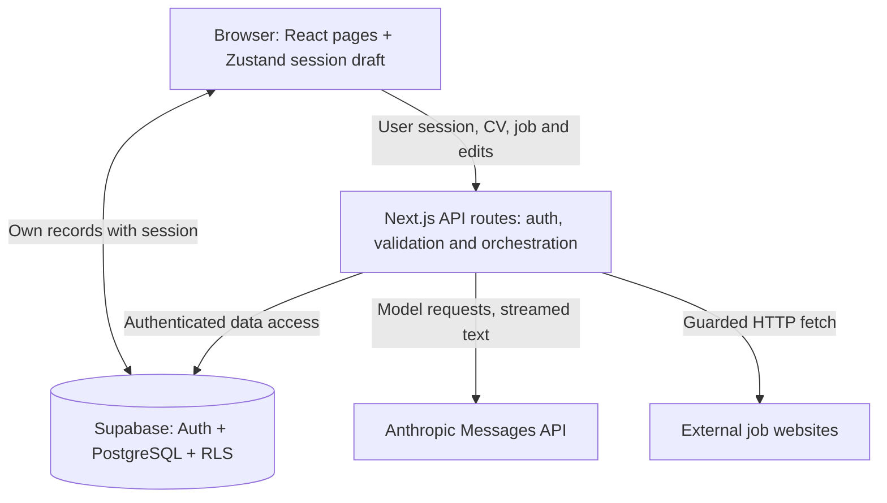
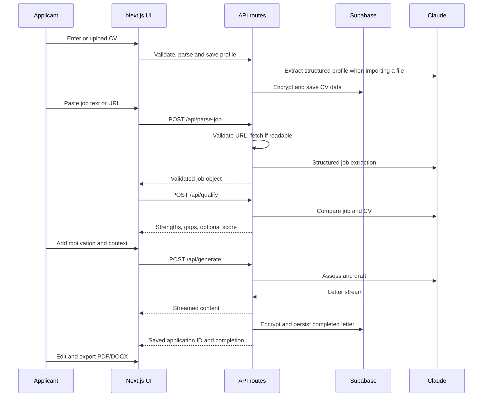

# Architecture

This document describes the **implemented application**; earlier exploratory design sketches are intentionally excluded from this public portfolio.

## Context and responsibilities

### Major modules

| Concern | Main entry points |
| --- | --- |
| Pages and application flow | `src/app/[locale]/cv/`, `src/app/[locale]/apply/`, `src/app/[locale]/history/` |
| API authentication, validation and errors | `src/lib/api-helpers.ts` and `src/app/api/` |
| User session and persisted data | `src/lib/supabase/`, `supabase/schema.sql`, `supabase/migrations/` |
| Job extraction | `src/app/api/parse-job/route.ts`, `src/lib/job-content.ts`, `src/lib/job-text.ts` |
| External URL safety | `src/lib/url-safety.ts` |
| Claude API, output schemas and budgets | `src/lib/anthropic.ts`, `src/lib/ai-output.ts`, `src/lib/ai-budget.ts` |
| Prompts and CV-to-job assessment | `src/lib/prompts.ts`, `src/lib/cv-matching.ts`, `src/lib/schemas.ts` |
| Letter creation and persistence | `src/lib/letter-generation.ts`, `src/app/api/generate/route.ts` |
| Editing, export and temporary UI state | `src/app/[locale]/apply/result/`, `src/lib/letter-export.ts`, `src/store/application.ts` |
| Encryption and observability | `src/lib/encryption.ts`, `src/lib/logger.ts` |

## Application flow

The score is generated by an LLM and should **never** be interpreted as a calibrated probability of hiring success. If matching fails, the generation flow can continue without a score in supported cases. Budget and infrastructure failures remain blocking.

## Trust boundaries and sensitive data

1. **Browser to application:** UI inputs are untrusted. API handlers authenticate requests and use schema validation; the UI itself is not the trust boundary.
2. **Application to Supabase:** user CVs and saved letters are encrypted with AES-256-GCM before persistence. Supabase row-level security separates user records. Some service-side tables, such as AI quota and URL-cache data, have separate restricted access rules. The service-role key must never be bundled into client code.
3. **Application to model:** CV details and job context are sent to an external AI provider when AI features are used. Prompt instructions and schemas reduce formatting errors, but neither can guarantee factual correctness.
4. **Application to external URLs:** public job URLs are DNS/IP and redirect checked and response-size limited. A blocked or unreadable page triggers a manual-text fallback.
5. **Browser persistence:** an in-progress application draft is kept in `sessionStorage` and cleared on sign-out. Sensitive test data should not be used on shared browsers.
6. **Logs:** request metadata and AI usage may be logged; raw CVs, prompts, letters, and credentials should not be logged. Error paths deserve continued review when changing logging.

Secrets are loaded through environment variables. Encryption keys are version-aware; rotating one requires preserving keys needed for previously stored data. The database schema and migrations must be reviewed before any live rollout.

## AI pipeline: deliberate boundaries

- **CV import:** PDF/DOCX text extraction, Claude parsing, Zod validation; manual profile input remains available.
- **Job analysis:** fetch-or-paste text, structured output schema, semantic validation, optional per-user 24-hour URL cache.
- **Matching:** a separate prompt extracts evidence and gaps; score may be null. It is not a deterministic eligibility engine.
- **Writing:** prompt assembled from the CV, job and explicit user context. The draft streams to the UI, but the server only emits successful completion after a full provider response and confirmed persistence.
- **Operational safeguards:** per-user rate limiting plus shared daily call/token reservation, explicit timeouts and bounded retries.

The parser, matcher and writer are separate stages because they have different input formats, validation strategies and failure behavior. This is a deliberate tradeoff: easier testing and clearer errors, at the cost of extra latency and model calls.

## Testing and CI

- **Unit tests:** `src/lib/__tests__/` and `src/store/__tests__/` (validation, security helpers, AI adapters, draft behavior).
- **API tests:** `src/app/api/**/*.test.ts` (auth, endpoints, parser/transport behavior).
- **Database checks:** `npm run check:db` executes migration and access checks with isolated PGlite; it does not back up the deployed database.
- **Browser tests:** `tests/e2e/` uses Playwright, mocked application API calls and a local Supabase auth fixture.
- **CI:** `.github/workflows/ci.yml` runs TypeScript, lint, tests, DB checks, dependency audit, build and browser tests on pull requests.

Not covered by these checks: independent security penetration testing, genuine end-to-end production authentication and paid-model generation, and a blinded evaluation demonstrating improved letter quality. See [writing-quality notes](writing-quality.md) for a proposed evaluation protocol.

## Historical design artifacts

Early UI and architecture sketches were intentionally excluded from this portfolio because they reflected superseded implementation assumptions.
